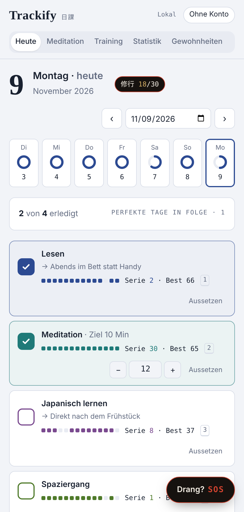
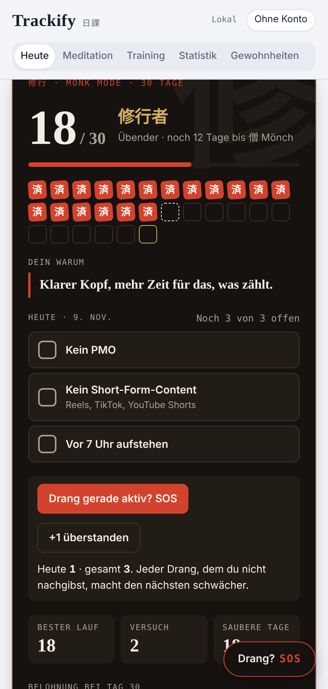
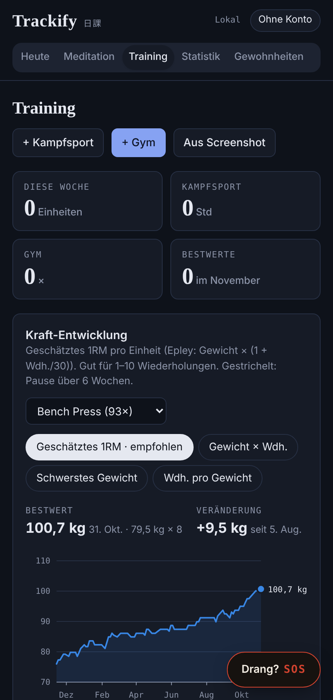

# Trackify 日課

Ein Habit Tracker für Leute, die mehr wollen als Häkchen: Gewohnheiten mit Serien und Statistik, ein strenger **Monk Mode**, eine **Drang-Hilfe** für schwache Momente, **Meditation und Breathwork** mit Klängen und ein **Trainingslog** mit Kraftkurven. Alles in einer App, im Browser und auf dem Handy.

<p>
  
  
  
  
</p>

## Funktionen

| Bereich | Was es kann |
|---|---|
| **Gewohnheiten** | Abhaken oder Zahl mit Ziel, geplante Wochentage, „Wann und wo“-Plan, Aussetzen ohne Serienbruch, Hinweis „Nicht zweimal verpassen“ |
| **Statistik** | Jahres-Heatmap in fünf Stufen, Auswertung nach Wochentag und Monat, Serien und Quoten |
| **Monk Mode** | Frei wählbare Regeln, Dauer von 15 bis 90 Tagen, Reset bei einem Fehltag, Nachtragen bis Mitternacht, Ränge, Rückfall nur mit Begründung |
| **Drang-Hilfe** | Timer mit Atemführung, Auslöser erfassen, zufällige Alternative, Auswertung der häufigsten Auslöser |
| **Meditation** | Stille Meditation mit Gong, sechs Breathwork-Muster, Hintergrundklänge und Signale bei jedem Phasenwechsel (alles per Web Audio erzeugt), automatischer Eintrag in die passende Gewohnheit |
| **Training** | Gym, BJJ, MMA, Kickboxen, Kardio; Sätze mit Gewicht und Wiederholungen, „Wie letztes Mal“, Bestwerte, Kraftkurven mit wählbarer Messgröße, Gesamtstatistik |
| **Screenshot-Import** | Liest einen Trainingsplan aus einem Google-Sheets-Screenshot per Texterkennung **direkt im Browser**, das Bild verlässt nie das Gerät |
| **Import** | Notion-Export (ZIP/CSV) mit Spaltenzuordnung und Erkennung von Krankheitstagen, Trainingsdaten-Import, JSON-Backup |
| **Konten** | Anmeldung per E-Mail-Link, Synchronisation zwischen Geräten, jeder sieht nur seine eigenen Daten |

## Technik

- **Vite + TypeScript**, kein UI-Framework. Die Oberfläche wird aus Template-Strings gerendert und über Event-Delegation gesteuert.
- **Supabase** für Login, Postgres-Datenbank und Live-Synchronisation. Row Level Security stellt sicher, dass jeder Nutzer nur seine eigenen Zeilen lesen und schreiben kann ([`supabase/migrations/001_init.sql`](supabase/migrations/001_init.sql)).
- **Dokumentenmodell**: Der Zustand ist in kleine JSON-Dokumente aufgeteilt (Gewohnheiten, je Monat Tage und Trainings, Monk Mode, Meditation). Beim Speichern wird nur das geänderte Dokument geschrieben, gebündelt mit 450 ms Verzögerung.
- **Austauschbares Backend** ([`src/storage/backend.ts`](src/storage/backend.ts)): Ohne Supabase-Konfiguration läuft die App komplett lokal mit `localStorage`.
- **Tesseract.js** für die Texterkennung. Worker, WebAssembly-Kern und Sprachdaten werden selbst ausgeliefert, kein externes CDN ([`scripts/copy-ocr-assets.mjs`](scripts/copy-ocr-assets.mjs)). Der Parser ([`src/ocr/parse.ts`](src/ocr/parse.ts)) erkennt Tage, Back-off-Sätze und ordnet Übungsnamen per Ähnlichkeitssuche bekannten Übungen zu.
- **Diagramme** als handgeschriebenes SVG mit Tooltips, ohne Chart-Bibliothek. Die Farben der Trainingsarten sind auf Farbenblindheit geprüft.
- **Tests** mit Vitest für Serien, Monk-Mode-Regeln, Datums- und CSV-Parser, 1RM-Berechnung und den Screenshot-Parser.
- **CI/CD** mit GitHub Actions: Tests, Build und Deployment auf GitHub Pages bei jedem Push auf `main`.

## Lokal starten

```bash
npm install
npm run dev        # http://localhost:5173
npm test
npm run build
```

Ohne `.env` läuft die App im lokalen Modus. Für Konten `.env.example` nach `.env` kopieren und die Supabase-Werte eintragen.

## Eigene Instanz einrichten

1. **Supabase-Projekt anlegen** (kostenlos) auf [supabase.com](https://supabase.com).
2. Im **SQL Editor** den Inhalt von `supabase/migrations/001_init.sql` ausführen.
3. Unter **Authentication → URL Configuration** die Site URL auf `https://<dein-name>.github.io/<repo>/` setzen und dieselbe Adresse bei den Redirect URLs eintragen.
4. Unter **Settings → API** die Project URL und den `anon`-Key kopieren. Der `anon`-Key darf öffentlich sein, weil die Zugriffsregeln in der Datenbank greifen.
5. Im GitHub-Repo unter **Settings → Secrets and variables → Actions** die Secrets `VITE_SUPABASE_URL` und `VITE_SUPABASE_ANON_KEY` anlegen.
6. Unter **Settings → Pages** als Quelle **GitHub Actions** wählen und auf `main` pushen.

## Datenschutz

Jeder Nutzer sieht nur seine eigenen Daten. Wer das Supabase-Projekt betreibt, hat als Administrator technisch Zugriff auf die Datenbank. Screenshots für die Texterkennung werden nur im Browser verarbeitet und nirgends hochgeladen. Unter **Konto** lassen sich alle Daten als JSON exportieren oder vollständig löschen.

## Projektstruktur

```
src/
  main.ts              Einstieg, Routing, Event-Delegation
  state.ts             Zustand der App und der Oberfläche
  storage/             Backend-Interface, Supabase, lokal, Persistenz
  domain/habits.ts     Serien, Quoten, Tageswerte
  features/            Monk Mode, Drang-Hilfe, Meditation, Training, Import, Konto
  ocr/                 Texterkennung und Plan-Parser
  views/               Heute, Statistik, Gewohnheiten
tests/                 Vitest
supabase/migrations/   Datenbankschema mit Row Level Security
```

## Nächste Schritte

- Die aus der ersten Version übernommenen Module sind noch mit `// @ts-nocheck` markiert. Neue Module (Speicher, Texterkennung, Parser) sind streng typisiert. Die übrigen werden nach und nach typisiert.
- Offline-Unterstützung per Service Worker.

## Lizenz

MIT
